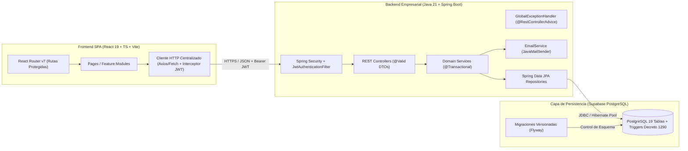

# AUDITORÍA TÉCNICA INTEGRAL — PLATAFORMA WEB INSTITUCIONAL EDUCONNECT

**Fecha de Auditoría:** Noviembre 2026  
**Equipo Auditor:** Arquitectura Empresarial, Ingeniería Frontend (React/TypeScript), Ingeniería Backend (Java/Spring Boot), Base de Datos (PostgreSQL/Supabase), Ciberseguridad y UX/UI  
**Alcance:** Repositorio completo `Plataforma-web-institucional` (Fase 1 — Exclusivamente Auditoría sin modificación de código ni datos)

---

## ÍNDICE DEL INFORME

1. [Resumen Ejecutivo del Estado Actual](#1-resumen-ejecutivo-del-estado-actual)
2. [Arquitectura Tecnológica Detectada](#2-arquitectura-tecnológica-detectada)
3. [Estructura Actual de Carpetas](#3-estructura-actual-de-carpetas)
4. [Problemas Críticos Encontrados (Prioridad CRÍTICA)](#4-problemas-críticos-encontrados-prioridad-crítica)
5. [Problemas Importantes (Prioridad ALTA y MEDIA)](#5-problemas-importantes-prioridad-alta-y-media)
6. [Problemas Menores (Prioridad BAJA)](#6-problemas-menores-prioridad-baja)
7. [Vulnerabilidades de Seguridad y Exposición de Secretos](#7-vulnerabilidades-de-seguridad-y-exposición-de-secretos)
8. [Estado de Autenticación y Control de Acceso](#8-estado-de-autenticación-y-control-de-acceso)
9. [Estado de la Base de Datos y Discrepancias de Esquema](#9-estado-de-la-base-de-datos-y-discrepancias-de-esquema)
10. [Estado Detallado de Cada Módulo (16 Módulos)](#10-estado-detallado-de-cada-módulo-16-módulos)
11. [Funcionalidades que Funcionan Realmente](#11-funcionalidades-que-funcionan-realmente)
12. [Funcionalidades Simuladas o Incompletas](#12-funcionalidades-simuladas-o-incompletas)
13. [Arquitectura Profesional Recomendada](#13-arquitectura-profesional-recomendada)
14. [Estructura de Carpetas Propuesta](#14-estructura-de-carpetas-propuesta)
15. [Plan de Modernización por Fases](#15-plan-de-modernización-por-fases)
16. [Auditoría de Dependencias (Instalar, Actualizar, Eliminar)](#16-auditoría-de-dependencias-instalar-actualizar-eliminar)
17. [Estrategia de Pruebas a Implementar](#17-estrategia-de-pruebas-a-implementar)
18. [Riesgos de Modernización y Plan de Mitigación](#18-riesgos-de-modernización-y-plan-de-mitigación)

---

## 1. RESUMEN EJECUTIVO DEL ESTADO ACTUAL

**EduConnect** cuenta con una interfaz visual atractiva (basada en diseño oscuro institucional "Creatix") y un esquema SQL relacional bien intencionado en `database/schema.sql` (alineado conceptualmente con el Decreto 1290 y la Ley 1620 de Colombia). Sin embargo, desde el punto de vista de **ingeniería de software, arquitectura empresarial y ciberseguridad**, el proyecto se encuentra en un **estado de prototipo fragmentado ( híbrido entre maqueta interactiva y aplicación en transición)** que **no es apto para producción ni para pruebas con datos reales**.

### Hallazgos Estructurales Principales:

1. **Desconexión Total entre Frontend y Backend Spring Boot:**
   - Aunque existe un servidor backend en Java 21 + Spring Boot (`backend/`) y un proxy configurado en `frontend/vite.config.ts` hacia `http://localhost:8080`, **el frontend nunca consume los endpoints REST de Spring Boot** (con la única excepción de un fallback secundario en `frontend/src/services/emailService.ts`).
   - En su lugar, el archivo monolítico `frontend/src/services/api.ts` (1.678 líneas) realiza consultas directas desde el navegador hacia **Supabase** usando `@supabase/supabase-js`, las combina con persistencia local en **`localStorage`** del navegador y rellena los vacíos con **arreglos estáticos simulados (mock data)**.

2. **Incompatibilidad Estructural entre el Frontend (`api.ts`) y la Base de Datos (`database/schema.sql`):**
   - El script `database/schema.sql` fue actualizado a una "Versión 2.0 Enterprise" normalizada (`primer_nombre`, `primer_apellido`, `nota_cognitiva`, `nota_procedimental`, `nota_actitudinal`, `carga_academica_id`, roles en `MAYÚSCULAS`), pero `frontend/src/services/api.ts` sigue consultando e insertando columnas de una versión antigua (`nombre`, `apellido`, `nota1`, `nota2`, `nota3`, `nota_final`, roles en `minúsculas`).
   - Como consecuencia, la mayoría de las operaciones CRUD que `api.ts` intenta ejecutar contra Supabase **fallan silenciosamente** por violación de columnas inexistentes o restricciones `NOT NULL` / `CHECK`, activando bloques `catch` que devuelven datos ficticios o guardan en `localStorage`, dando una **falsa sensación de operatividad**.

3. **Fallas Críticas de Ciberseguridad y Autenticación:**
   - Coexisten dos mecanismos de autenticación incompatibles: el backend usa **BCrypt + JWT**, mientras que el frontend descarga el registro de `usuarios` desde Supabase al navegador y compara `usuario.password_hash !== password` **en texto plano**.
   - Los botones de "Acceso Rápido" en el login (`CreatixEduConnect.tsx`) contienen un bloque `.catch()` que **inicia sesión automáticamente con un token falso (`demo-token-...`) cuando la autenticación falla**, permitiendo acceso total sin credenciales válidas.
   - Una barra superior (`role-switcher-bar` en `App.tsx`) permite a cualquier usuario autenticado cambiar su rol activo a `ADMIN`, `RECTOR`, `COORDINADOR`, `DOCENTE`, `ESTUDIANTE` o `TUTOR` en el cliente sin validación del servidor.
   - Existen **credenciales reales expuestas en texto plano** dentro del código fuente versionado (contraseñas de aplicación de Gmail, claves de Supabase, secreto JWT y credenciales por defecto de base de datos).

4. **Tercer Backend Fantasma (Python/FastAPI):**
   - Los módulos de **Telemetría** y **MIPA** (`frontend/src/services/api.ts` L1534-1676) intentan conectarse a `http://127.0.0.1:8000/api/v1/...` (un supuesto microservicio en Python/FastAPI que **no existe en el repositorio**) y, al fallar por timeout de 1.8 segundos, muestran datos estáticos prefabricados.

5. **Herencia de una Aplicación Web Monolítica Anterior:**
   - Se detectan vestigios claros de una aplicación web estática previa (HTML/CSS tradicional): carpetas de imágenes triplicadas (`IMG/`, `frontend/public/IMG/`, `frontend/src/IMG/`), 3.789 líneas de archivos CSS huérfanos en `frontend/src/CSS/` que ningún componente importa, un `package.json` en la raíz duplicando dependencias del frontend, ausencia de enrutador (`react-router-dom`) y envío de correos incrustado como un plugin del servidor de desarrollo de Vite (`frontend/src/server/emailPlugin.ts`).

---

## 2. ARQUITECTURA TECNOLÓGICA DETECTADA

| Capa | Tecnología Detectada | Estado Real en el Repositorio |
| :--- | :--- | :--- |
| **Frontend** | React 19 + TypeScript + Vite | SPA sin enrutador (`react-router-dom` ausente). Navegación basada en estados locales (`useState`). Dependencias `node_modules` no instaladas actualmente en el entorno local. |
| **Estilos UI** | CSS puro (`src/index.css` - 1.422 líneas) + estilos inline | Uso intensivo de `style={{ ... }}` en componentes `.tsx`. Carpeta `src/CSS/` (4 archivos, 3.789 líneas) completamente sin usar. |
| **Cliente de Datos Frontend** | `@supabase/supabase-js` + `localStorage` | `src/services/api.ts` actúa como backend improvisado en el navegador: consulta tablas directamente con la clave pública de Supabase y usa `localStorage` como base de datos secundaria. |
| **Servidor de Correos (Dev)** | Plugin personalizado de Vite + `nodemailer` | `src/server/emailPlugin.ts` monta endpoints `/api-mail/*` dentro del servidor de desarrollo de Vite. **Deja de existir al compilar a producción (`vite build`)**. |
| **Backend Principal** | Java 21 + Spring Boot 4.1.1 + Maven | Compila correctamente (`46 clases`), pero solo tiene **3 controladores** (`AuthController`, `AdminController`, `CalificacionController`) y **ninguno es consumido regularmente por el frontend**. |
| **Seguridad Backend** | Spring Security + JJWT (`0.12.5`) + BCrypt | Configurado parcialmente en `SecurityConfig.java`, pero desconectado del flujo de login que realiza el frontend contra Supabase. |
| **Backend Secundario (Fantasma)** | Supuesto Python / FastAPI (`127.0.0.1:8000`) | Referenciado en `api.ts` (L1534) y `MipaTelemetriaPanel.tsx`, pero **inexistente en el proyecto**. |
| **Base de Datos** | PostgreSQL / Supabase (`database/schema.sql`) | Esquema relacional de 19 tablas con triggers PL/pgSQL, vistas y datos semilla. Presenta colisiones severas de nombres de columnas y llaves foráneas frente a `api.ts`. |

```mermaid
flowchart TD
    subgraph Navegador["Navegador del Usuario (Frontend React)"]
        UI["Componentes Dashboard (11 vistas)"]
        AuthCtx["AuthContext (localStorage)"]
        ApiTs["services/api.ts (1.678 líneas)"]
        LocalStore[("localStorage + Mock Data")]
        EmailSrv["services/emailService.ts"]
    end

    subgraph ViteDev["Servidor Vite Dev (Solo Desarrollo)"]
        VitePlugin["server/emailPlugin.ts (Nodemailer)"]
    end

    subgraph Nube["Supabase / PostgreSQL"]
        SupaDB[("Base de Datos PostgreSQL (19 tablas)")]
    end

    subgraph Spring["Backend Spring Boot (Puerto 8080)"]
        SBAuth["AuthController / AdminController / CalificacionController"]
    end

    subgraph Ghost["Microservicio Inexistente (Puerto 8000)"]
        FastAPI["Python FastAPI (No existe)"]
    end

    UI --> AuthCtx
    UI --> ApiTs
    ApiTs -->|Consultas directas con clave pública| SupaDB
    ApiTs -->|Fallback silencioso / Persistencia local| LocalStore
    ApiTs -.->|Timeout 1.8s -> Mock Fallback| FastAPI
    UI --> EmailSrv
    EmailSrv -->|1ra opción| VitePlugin
    EmailSrv -.->|Fallback secundario| SBAuth
    SBAuth -.->|JPA / Hibernate (No usado por UI)| SupaDB
```

---

## 3. ESTRUCTURA ACTUAL DE CARPETAS

```text
Plataforma-web-institucional/
├── IMG/                                  # [DUPLICADO #1] 11 imágenes institucionales en la raíz
├── package.json                          # [RESIDUAL] Dependencia @supabase/supabase-js en la raíz
├── README.md                             # Documentación superficial y desactualizada
├── database/
│   └── schema.sql                        # Esquema PostgreSQL v2.0 (584 líneas, incluye DROP SCHEMA destructivo)
├── backend/                              # Proyecto Maven Spring Boot (Java 21)
│   ├── pom.xml                           # Configurado con spring-boot-starter-parent 4.1.1
│   └── src/
│       ├── main/
│       │   ├── java/com/educonnect/
│       │   │   ├── EduconnectBackendApplication.java
│       │   │   ├── controller/           # Solo 3 controladores (Admin, Auth, Calificacion)
│       │   │   ├── dto/                  # Solo 7 DTOs (faltan DTOs de salida para entidades)
│       │   │   ├── model/                # 17 clases (16 entidades JPA + 1 enum Rol; faltan 8 tablas del SQL)
│       │   │   ├── repository/           # Solo 11 repositorios (faltan 5 de entidades existentes)
│       │   │   ├── security/             # 4 clases (SecurityConfig, JwtTokenProvider, Filter, UserDetails)
│       │   │   └── service/              # Solo 3 servicios (AdminService, AuthService, CalificacionService)
│       │   └── resources/
│       │       └── application.properties # [CRÍTICO] Contiene credenciales y secretos expuestos
│       └── test/
│           └── java/com/educonnect/
│               └── EduconnectBackendApplicationTests.java # Prueba vacía (contextLoads)
└── frontend/                             # Aplicación React + TypeScript + Vite
    ├── package.json                      # Incluye paquetes de servidor (nodemailer) en dependencies
    ├── tsconfig.json
    ├── vite.config.ts                    # Registra emailServerPlugin() y proxy /api -> localhost:8080
    ├── public/
    │   └── IMG/                          # [DUPLICADO #2] Copia exacta de las 11 imágenes
    └── src/
        ├── App.tsx                       # Enrutador manual por estado + Barra de cambio libre de rol
        ├── main.tsx
        ├── index.css                     # Hoja de estilos activa (1.422 líneas)
        ├── CSS/                          # [CÓDIGO MUERTO] 4 archivos CSS (3.789 líneas) no importados
        │   ├── style.css
        │   ├── dashboard-admin.css
        │   ├── dashboard-docente.css
        │   └── dashboard-estudiante.css
        ├── IMG/                          # [DUPLICADO #3] Tercera copia de las mismas imágenes
        ├── components/                   # 13 componentes mezclados en una sola carpeta plana
        │   ├── AdminDashboard.tsx        # Monolito de 1.188 líneas
        │   ├── BoletinOficialModal.tsx
        │   ├── CoordinadorDashboard.tsx  # 640 líneas
        │   ├── CreatixEduConnect.tsx     # Landing + Login + Modales legales (571 líneas)
        │   ├── DirectorGrupoDashboard.tsx # [CÓDIGO MUERTO] No se importa en App.tsx (326 líneas)
        │   ├── DocenteDashboard.tsx      # Monolito de 901 líneas (absorbe Director de Grupo)
        │   ├── EduBot.tsx                # 431 líneas
        │   ├── EstudianteDashboard.tsx   # 416 líneas
        │   ├── HorarioSemanalGrid.tsx
        │   ├── MipaTelemetriaPanel.tsx
        │   ├── RectorDashboard.tsx       # 542 líneas
        │   ├── RecuperarClaveModal.tsx   # 433 líneas
        │   └── TutorDashboard.tsx        # 522 líneas
        ├── context/
        │   └── AuthContext.tsx           # Estado de sesión en localStorage sin validación de token
        ├── server/
        │   └── emailPlugin.ts            # [CRÍTICO] Código Node.js/Nodemailer con credenciales dentro de src/
        ├── services/
        │   ├── api.ts                    # [CRÍTICO] Super-objeto de 1.678 líneas con lógica de BD y mocks
        │   ├── edubotBrain.ts            # Motor NLP basado en expresiones regulares y respuestas fijas
        │   ├── emailService.ts           # Cliente de envío de correos (devuelve el código OTP al frontend)
        │   └── supabase.ts               # Cliente Supabase con URL y API Key hardcodeadas
        └── types/
            └── index.ts                  # Solo 33 líneas (tipos básicos de autenticación; el resto usa any)
```

### ¿Corresponde a una aplicación React profesional?
**No.** La estructura actual conserva patrones de una aplicación web estática/tradicional migrada apresuradamente:
- No existe separación entre **vistas/páginas (`pages/`)**, **componentes de dominio (`features/`)** y **componentes UI reutilizables (`components/ui/`)**.
- Todos los paneles son componentes monolíticos de entre 400 y 1.200 líneas que mezclan llamadas a base de datos, lógica de negocio, validaciones, estados de formularios y tablas HTML con estilos en línea (`style={{ ... }}`).
- El código de servidor (`src/server/emailPlugin.ts`) está ubicado dentro del árbol `src/` del cliente React.

---

## 4. PROBLEMAS CRÍTICOS ENCONTRADOS (PRIORIDAD CRÍTICA)

| ID | Problema Crítico | Archivo y Ubicación Aproximada | Impacto Técnico y de Negocio | Prioridad |
| :--- | :--- | :--- | :--- | :---: |
| **CRIT-01** | **Comparación y almacenamiento de contraseñas en texto plano desde el navegador** | `frontend/src/services/api.ts` (L68-73, L113, L242, L355) | El frontend descarga la fila completa de `usuarios` desde Supabase al navegador y ejecuta `if (usuario.password_hash !== password)`. Al crear usuarios o restablecer claves desde el frontend, guarda la contraseña sin cifrar en `password_hash`. | **CRÍTICA** |
| **CRIT-02** | **Bypass total de autenticación en botones de Acceso Rápido** | `frontend/src/components/CreatixEduConnect.tsx` (L103-138) | En `handleQuickLogin`, si `api.login()` falla (por ejemplo, porque el hash BCrypt de `schema.sql` no coincide con el texto plano o no hay conexión), el bloque `.catch()` (L113-135) construye un usuario artificial con `token: demo-token-${Date.now()}` e inicia sesión automáticamente en cualquier rol (`ADMIN`, `RECTOR`, etc.). | **CRÍTICA** |
| **CRIT-03** | **Escalación horizontal y vertical de privilegios en el cliente (`role-switcher-bar`)** | `frontend/src/App.tsx` (L16, L44, L90-128) | Cualquier usuario autenticado (ej. un estudiante) dispone de una barra superior fija que cambia `activeRoleOverride` y renderiza inmediatamente el panel de `ADMIN`, `RECTOR`, `COORDINADOR`, `DOCENTE` o `TUTOR`. Como `api.ts` usa la misma clave de Supabase sin validar sesión de servidor, el usuario puede ejecutar acciones administrativas. | **CRÍTICA** |
| **CRIT-04** | **Exposición de credenciales reales en texto plano dentro del repositorio** | `backend/src/main/resources/application.properties` (L9-10, L23, L37-38)<br>`frontend/src/server/emailPlugin.ts` (L5-6)<br>`frontend/src/services/supabase.ts` (L3-4) | Credenciales de correo institucional (usuario y clave de aplicación de Google), secreto criptográfico JWT, credenciales de BD y llave de Supabase están escritos directamente en archivos rastreados por Git. | **CRÍTICA** |
| **CRIT-05** | **Fuga del código OTP de recuperación de contraseña en pantalla y en respuestas HTTP** | `frontend/src/services/api.ts` (L174)<br>`frontend/src/services/emailService.ts` (L47, L70, L81)<br>`frontend/src/components/RecuperarClaveModal.tsx` (L58-60, L323-346)<br>`backend/src/main/java/com/educonnect/service/AuthService.java` (L162) | El código OTP de 6 dígitos se genera en el navegador (`Math.random()`), se retorna en la propiedad `devCode` y se muestra en un banner amarillo en pantalla (`RecuperarClaveModal.tsx` L323) cuando el envío de correo falla o en modo demo. Además, el backend en `AuthService.java` (L162) devuelve `"codigo", codigo` en el JSON de respuesta. Cualquier atacante puede tomar control de cualquier cuenta conociendo solo su email. | **CRÍTICA** |
| **CRIT-06** | **Desconexión arquitectónica entre el Frontend y el Backend Spring Boot** | `frontend/src/services/api.ts` (L1-1678)<br>`backend/src/main/java/com/educonnect/controller/*` | El frontend ignora la API REST de Spring Boot (`/api/v1/*`) y opera directamente contra Supabase y `localStorage`. Toda la capa de seguridad, validaciones y lógica transaccional de Spring Boot queda inactiva en la práctica. | **CRÍTICA** |
| **CRIT-07** | **Incompatibilidad severa entre las consultas de `api.ts` y el esquema `database/schema.sql`** | `frontend/src/services/api.ts` (L80, L110-114, L280, L332, L522, L612-713, L720, L958)<br>`database/schema.sql` (L19-34, L170-245, L350-361) | `api.ts` consulta e inserta columnas que no existen en `schema.sql` (`nombre`, `apellido`, `nota1`, `nota2`, `nota3`, `nota_final`, `intensidad_horaria`, `grupo_nombre`) e inserta roles en minúsculas (`estudiante`, `docente`) violando el `CHECK (rol IN ('ADMIN', ...))` en mayúsculas de PostgreSQL. | **CRÍTICA** |
| **CRIT-08** | **Autoregistro público con asignación arbitraria de rol (`ADMIN` / `RECTOR`)** | `backend/src/main/java/com/educonnect/controller/AuthController.java` (L28-31)<br>`backend/src/main/java/com/educonnect/security/SecurityConfig.java` (L48)<br>`backend/src/main/java/com/educonnect/dto/RegisterRequest.java` (L26) | El endpoint `POST /api/v1/auth/register` es completamente público (`permitAll()`) y recibe el campo `rol` en el cuerpo JSON sin restricción, permitiendo que cualquier persona externa cree una cuenta con rol `ADMIN` o `RECTOR`. | **CRÍTICA** |
| **CRIT-09** | **Exposición de hashes de contraseñas y error de serialización Lazy en `AdminController`** | `backend/src/main/java/com/educonnect/controller/AdminController.java` (L26-34)<br>`backend/src/main/java/com/educonnect/model/Usuario.java` (L27)<br>`backend/src/main/java/com/educonnect/model/Grupo.java` (L25-33) | `GET /api/v1/admin/usuarios` devuelve la entidad JPA `Usuario` directamente sin DTO ni `@JsonIgnore` en `passwordHash`, exponiendo los hashes BCrypt de todos los usuarios. Asimismo, `GET /api/v1/admin/grupos` devuelve entidades `Grupo` con relaciones `FetchType.LAZY` sin inicializar, provocando errores 500 (`InvalidDefinitionException` / `LazyInitializationException`). | **CRÍTICA** |
| **CRIT-10** | **Script SQL destructivo en `database/schema.sql`** | `database/schema.sql` (L8-11) | Las primeras líneas ejecutan `DROP SCHEMA IF EXISTS public CASCADE; CREATE SCHEMA public; GRANT ALL ON SCHEMA public TO public;`. Ejecutar este archivo en un entorno con datos elimina irreversiblemente toda la base de datos y otorga permisos excesivos al rol `public`. | **CRÍTICA** |

---

## 5. PROBLEMAS IMPORTANTES (PRIORIDAD ALTA Y MEDIA)

| ID | Problema Encontrado | Archivo y Ubicación Aproximada | Descripción Detallada | Prioridad |
| :--- | :--- | :--- | :--- | :---: |
| **IMP-01** | **Corrupción de llaves foráneas en los datos semilla (`seed data`) de `schema.sql`** | `database/schema.sql` (L388-396 vs L438-458) | En `usuarios`, los IDs generados son: `1=ADMIN`, `2=RECTOR`, `3=COORDINADOR`, `4=DIRECTOR_GRUPO (Roberto Silva)`, `5=DOCENTE (Elena Gómez)`, `6=TUTOR (Juan Ramírez)`, `7=ESTUDIANTE (Carlos Vargas)`. Sin embargo, al insertar en `docentes` (L438-441) se asigna `usuario_id=2` (el Rector) a Roberto Silva y `usuario_id=3` (la Coordinadora) a Elena Gómez; en `tutores` (L450) se asigna `usuario_id=4` (Prof. Silva) al tutor Juan Ramírez; y en `estudiantes` (L455) se asigna `usuario_id=5` (Prof. Gómez) al estudiante Lucas Mateo. | **ALTA** |
| **IMP-02** | **Endpoint de modificación de calificaciones desprotegido por rol en el Backend** | `backend/src/main/java/com/educonnect/security/SecurityConfig.java` (L46-56)<br>`backend/src/main/java/com/educonnect/controller/CalificacionController.java` (L22-28) | `SecurityConfig` no incluye ninguna regla para `/api/v1/calificaciones/**`, cayendo en `.anyRequest().authenticated()`. Cualquier usuario con sesión válida (incluso un `ESTUDIANTE` o `TUTOR`) puede enviar un `POST /api/v1/calificaciones` para alterar notas. Además, `CalificacionController` L26 tiene un fallback peligroso: `userDetails != null ? userDetails.getUsername() : "prof.silva@educonnect.edu.co"`. | **ALTA** |
| **IMP-03** | **Roles institucionales omitidos en `SecurityConfig.java`** | `backend/src/main/java/com/educonnect/security/SecurityConfig.java` (L51-54) | El enum `Rol.java` define 8 roles (`ADMIN`, `RECTOR`, `COORDINADOR`, `DIRECTOR_GRUPO`, `DOCENTE`, `ESTUDIANTE`, `TUTOR`, `ADMINISTRATIVO`), pero `SecurityConfig` solo configura rutas para 4 de ellos (`ADMIN`, `DOCENTE`, `ESTUDIANTE`, `TUTOR`). | **ALTA** |
| **IMP-04** | **Anulación de valores por defecto en entidades JPA por mal uso de `@Builder` de Lombok** | `backend/src/main/java/com/educonnect/model/*.java` (14 entidades, ej. `PeriodoAcademico.java` L46, `Usuario.java` L46-57, `Calificacion.java` L54-56) | Las entidades usan `@Builder` a nivel de clase junto con inicializadores de campo (`private Boolean estado = true;`, `private LocalDateTime fechaCreacion = LocalDateTime.now();`) sin la anotación `@Builder.Default`. El compilador `javac` advierte que Lombok ignora estas expresiones al usar `.builder().build()`, dejando los campos en `null` y provocando fallos de restricción `NOT NULL` en PostgreSQL. | **ALTA** |
| **IMP-05** | **Uso de la letra `ñ` y comillas dobles escapadas en identificadores SQL y mapeos JPA** | `database/schema.sql` (L126, L149, L182, L215, L352)<br>`backend/src/main/java/com/educonnect/model/AnioLectivo.java` (L10, L19)<br>`Matricula.java` (L11, L25) | Se nombran tablas y columnas con `ñ` (`"años_lectivos"`, `"año"`, `"año_lectivo_id"`). En `Matricula.java` L11 se define `@UniqueConstraint(columnNames = {"estudiante_id", "año_lectivo_id"})` sin comillas escapadas mientras que en L25 se usa `@JoinColumn(name = "\"año_lectivo_id\"")` con comillas escapadas, generando inconsistencias en dialectos Hibernate/PostgreSQL. | **ALTA** |
| **IMP-06** | **Arquitectura de envío de correos atada al servidor de desarrollo de Vite (`emailPlugin.ts`)** | `frontend/src/server/emailPlugin.ts` (L1-190)<br>`frontend/vite.config.ts` (L7) | El envío de correos electrónicos mediante `nodemailer` se ejecuta como un middleware de `configureServer` en Vite. Cuando la aplicación se compila para producción (`npm run build`), este middleware desaparece por completo. Además, los endpoints `/api-mail/send-recuperacion` y `/api-mail/send-bienvenida` no tienen autenticación ni límite de peticiones (rate limiting), y `send-bienvenida` envía la contraseña del usuario en texto plano por correo (L162). | **ALTA** |
| **IMP-07** | **Ausencia de manejo global de excepciones (`@RestControllerAdvice`) en el Backend** | `backend/src/main/java/com/educonnect/controller/AuthController.java` (L24, L36, L51, L66) | No existe una clase `@ControllerAdvice`. Los servicios lanzan `RuntimeException` genéricas y los controladores las capturan manualmente devolviendo `ResponseEntity.badRequest().body(Map.of("error", e.getMessage()))`, o bien dejan que Spring devuelva trazas de error estándar sin formato uniforme ni códigos HTTP semánticos (`401`, `403`, `404`, `409`, `422`). | **ALTA** |
| **IMP-08** | **Ausencia de enrutamiento real (`react-router-dom`) y pérdida de historial de navegación** | `frontend/src/App.tsx` (L14-140) | Toda la aplicación vive bajo la misma URL (`/`). El cambio entre landing page, login y los 6 dashboards se controla mediante variables `useState`. El botón "Atrás" del navegador saca al usuario del sitio, no existen rutas protegidas por URL (`/admin`, `/docente`, etc.) y no es posible compartir enlaces profundos (deep linking). | **ALTA** |
| **IMP-09** | **Entidades JPA y Repositorios faltantes respecto al esquema de Base de Datos** | `backend/src/main/java/com/educonnect/model/`<br>`backend/src/main/java/com/educonnect/repository/` | De las 19 tablas de `schema.sql`, faltan **8 entidades JPA** en el backend (`resoluciones_rectorales`, `casos_convivencia`, `citaciones_padres`, `horarios_escolares`, `justificaciones_inasistencia`, `codigos_recuperacion`, `telemetria_ingresos`, `bitacora_mipa`). Además, 5 entidades existentes (`Asistencia`, `Comunicado`, `EstudianteTutor`, `Grado`, `ObservadorEstudiante`) no tienen interfaz `JpaRepository`. | **MEDIA** |
| **IMP-10** | **Persistencia fragmentada en `localStorage` que diverge entre navegadores y usuarios** | `frontend/src/services/api.ts` (L313, L373, L412, L430, L496, L865, L910, L1098, L1141, L1176, L1264, L1304, L1381, L1456) | Múltiples operaciones (solicitudes de cambio de nota, actas de grado, casos disciplinarios, justificaciones de acudientes, comunicados, observaciones, citaciones, configuraciones de rector) se guardan en llaves `educonnect_*` dentro de `localStorage`. Lo que registra un docente o tutor en su computador **nunca es visto por el coordinador o rector en otro dispositivo**. | **MEDIA** |
| **IMP-11** | **Componentes monolíticos gigantes y duplicación masiva de interfaz** | `frontend/src/components/AdminDashboard.tsx` (1.188 líneas)<br>`DocenteDashboard.tsx` (901 líneas)<br>`CoordinadorDashboard.tsx` (640 líneas) | Los dashboards concentran hasta 7 pestañas completas, múltiples modales, lógica de filtrado, exportación CSV/impresión y llamadas a API dentro de un solo archivo `.tsx`, dificultando el mantenimiento y las pruebas unitarias. | **MEDIA** |
| **IMP-12** | **Tipado débil y uso generalizado de `any` en TypeScript** | `frontend/src/types/index.ts` (33 líneas)<br>`frontend/src/components/*.tsx` | `types/index.ts` solo define 4 interfaces de autenticación. En los componentes y en `api.ts` se abusa de `useState<any[]>([])` y parámetros `: any`, anulando la seguridad de tipos de TypeScript. | **MEDIA** |

---

## 6. PROBLEMAS MENORES (PRIORIDAD BAJA)

| ID | Problema Menor | Archivo y Ubicación Aproximada | Descripción | Prioridad |
| :--- | :--- | :--- | :--- | :---: |
| **MEN-01** | **Archivos CSS heredados completamente huérfanos (3.789 líneas de código muerto)** | `frontend/src/CSS/style.css` (2.372 líneas)<br>`dashboard-admin.css` (1.058 líneas)<br>`dashboard-docente.css` (189 líneas)<br>`dashboard-estudiante.css` (170 líneas) | Ninguno de los 4 archivos dentro de `frontend/src/CSS/` es importado en `main.tsx`, `App.tsx` ni en los componentes. Solo `src/index.css` está activo. | **BAJA** |
| **MEN-02** | **Componente `DirectorGrupoDashboard.tsx` sin utilizar (código muerto)** | `frontend/src/components/DirectorGrupoDashboard.tsx` (L1-326)<br>`frontend/src/App.tsx` (L59-61) | Existe un componente dedicado para el Director de Grupo, pero `App.tsx` renderiza `<DocenteDashboard />` tanto para `DOCENTE` como para `DIRECTOR_GRUPO`, dejando `DirectorGrupoDashboard.tsx` completamente desconectado. | **BAJA** |
| **MEN-03** | **Triplicación de recursos gráficos (`IMG/`) en el repositorio** | `IMG/` (raíz)<br>`frontend/public/IMG/`<br>`frontend/src/IMG/` | Las mismas 11 imágenes institucionales (`.png` y `.jpg`) están copiadas en tres directorios distintos, incrementando innecesariamente el peso del repositorio. | **BAJA** |
| **MEN-04** | **Archivo `package.json` redundante en la raíz del repositorio** | `package.json` (raíz, L1-6) | Contiene únicamente `@supabase/supabase-js` sin scripts ni configuración de workspaces, causando confusión sobre dónde ejecutar `npm install`. | **BAJA** |
| **MEN-05** | **Ausencia de documentación OpenAPI / Swagger en el Backend** | `backend/pom.xml` | No se incluye `springdoc-openapi-starter-webmvc-ui`, por lo que la API REST carece de documentación interactiva autogenerada. | **BAJA** |
| **MEN-06** | **Deficiencias de accesibilidad web (a11y)** | `frontend/src/components/*.tsx` | Modales sin atributos `role="dialog"` ni `aria-modal="true"`, sin trampa de foco (focus trap) ni cierre con tecla `Escape`; botones de acción con íconos sin `aria-label` descriptivo; formularios donde los `<label>` no están asociados mediante `htmlFor` + `id`. | **BAJA** |

---

## 7. VULNERABILIDADES DE SEGURIDAD Y EXPOSICIÓN DE SECRETOS

> **NOTA DE CONFIDENCIALIDAD:** Cumpliendo estrictamente con las reglas de la auditoría, **no se reproduce ninguna contraseña, token, clave privada ni credencial** en este informe. Se documenta únicamente el archivo afectado, las líneas exactas y la naturaleza del riesgo.

### 7.1 Inventario de Credenciales y Secretos Expuestos en Código Fuente

| Archivo Afectado | Líneas Aprox. | Tipo de Exposición | Nivel de Riesgo |
| :--- | :---: | :--- | :---: |
| `backend/src/main/resources/application.properties` | L9 - L10 | Usuario y contraseña por defecto de PostgreSQL configurados como fallback en `${DB_USERNAME:...}` y `${DB_PASSWORD:...}`. | **ALTO** |
| `backend/src/main/resources/application.properties` | L23 | Clave secreta criptográfica hexadecimal de 256 bits para firma de tokens JWT (`app.jwt.secret`) escrita directamente como valor por defecto. Permite a cualquiera con acceso al repositorio falsificar tokens JWT válidos para cualquier rol. | **CRÍTICO** |
| `backend/src/main/resources/application.properties` | L37 - L38 | Dirección de correo institucional real y **Contraseña de Aplicación (App Password) de Google/Gmail en texto plano** (`spring.mail.username` y `spring.mail.password`). | **CRÍTICO** |
| `frontend/src/server/emailPlugin.ts` | L5 - L6 | Dirección de correo institucional real (`GMAIL_USER`) y **Contraseña de Aplicación de Google/Gmail en texto plano** (`GMAIL_PASS`) hardcodeadas como fallback en el código del frontend. | **CRÍTICO** |
| `frontend/src/services/supabase.ts` | L3 - L4 | URL del proyecto en la nube de Supabase y clave de acceso (`VITE_SUPABASE_ANON_KEY`) escritas directamente como valores por defecto en el cliente. | **ALTO** |
| `database/schema.sql` | L383 - L396 | Contraseña institucional de prueba documentada explícitamente en comentarios SQL y uso del mismo hash BCrypt idéntico para las 7 cuentas principales (incluyendo `ADMIN` y `RECTOR`). | **MEDIO** |
| `frontend/src/components/CreatixEduConnect.tsx` | L107, L144 | Contraseña por defecto asignada en estado inicial del formulario de login (`useState`) y enviada automáticamente en `handleQuickLogin`. | **ALTO** |

### 7.2 Otras Vulnerabilidades Críticas de Ciberseguridad

1. **Inyección HTML en Plantillas de Correo Electrónico (`frontend/src/server/emailPlugin.ts` L74-103 y L144-174):**
   - Los parámetros `nombre`, `email`, `rol` y `passwordTemporal` recibidos por POST en `/api-mail/send-recuperacion` y `/api-mail/send-bienvenida` se interpolan directamente en cadenas HTML (`${nombre}`, `${rol}`) sin sanitización ni escape de caracteres especiales, permitiendo inyección de HTML/phishing a través del servidor SMTP institucional.
2. **Envío de Contraseñas en Texto Plano por Correo (`frontend/src/server/emailPlugin.ts` L162 y `AdminDashboard.tsx` L335):**
   - Al crear un usuario en el panel de Administrador, se envía la contraseña en texto claro dentro del cuerpo del correo electrónico de bienvenida, violando las buenas prácticas de seguridad (OWASP ASVS V2).
3. **Configuración de CORS y CSRF (`backend/src/main/java/com/educonnect/security/SecurityConfig.java` L38-72):**
   - Aunque CORS restringe orígenes a `localhost:5173`, `localhost:3000` y `127.0.0.1:5173`, la lista está hardcodeada en código Java en lugar de inyectarse por variables de entorno por ambiente (`application.properties`).
4. **Ausencia de Políticas de Seguridad en Supabase (Row Level Security - RLS):**
   - `database/schema.sql` no habilita `ALTER TABLE ... ENABLE ROW LEVEL SECURITY;` en ninguna de las 19 tablas, y en la línea 11 ejecuta `GRANT ALL ON SCHEMA public TO public;`. Dado que el frontend se conecta directamente con la clave pública de Supabase (`supabase.ts`), cualquier usuario desde la consola de desarrollo del navegador (DevTools) puede ejecutar `supabase.from('usuarios').select('*')` o `supabase.from('calificaciones').delete()` sin restricción alguna en la base de datos.

---

## 8. ESTADO DE AUTENTICACIÓN Y CONTROL DE ACCESO

Esta dimensión presenta la mayor fractura arquitectónica del sistema:

### 8.1 Existencia de Dos Sistemas de Autenticación Simultáneos e Incompatibles
1. **Sistema A (Frontend -> Supabase Directo en `frontend/src/services/api.ts` L47-103):**
   - Es el sistema que realmente ejecuta la interfaz de usuario.
   - Realiza un `SELECT * FROM usuarios WHERE email = ...` desde el navegador.
   - Verifica `if (usuario.password_hash !== password)` comparando **texto plano**.
   - Como `database/schema.sql` almacena hashes BCrypt (`$2a$10$...`), **esta comparación siempre falla para los usuarios creados por el script SQL**, a menos que su contraseña haya sido sobrescrita en texto plano desde el frontend.
   - Cuando tiene éxito, genera un pseudo-token sin firma criptográfica: `supabase-session-${usuario.id}-${Date.now()}`.
2. **Sistema B (Backend Spring Boot en `AuthService.java` L32-91 + `JwtTokenProvider.java`):**
   - Implementa correctamente `PasswordEncoder` (`BCryptPasswordEncoder`), bloqueo de cuenta al 5.º intento fallido (`intentosFallidos >= 5`) y generación de token JWT HMAC-SHA con `jjwt`.
   - **Problema:** `frontend/src/services/api.ts` **nunca invoca `POST /api/v1/auth/login`**. Todo este código del backend está inactivo frente al frontend actual.

### 8.2 Almacenamiento de Sesión y Verificación de Roles
- `frontend/src/context/AuthContext.tsx` (L18-48) guarda el objeto `user` completo (incluyendo `rol` y `token`) en `localStorage.getItem('educonnect_user')`.
- Al recargar la página, `AuthContext` confía ciegamente en el contenido de `localStorage` sin verificar la validez ni expiración del token contra el backend.
- Cualquier usuario puede abrir las herramientas de desarrollador del navegador, modificar `"rol": "ESTUDIANTE"` por `"rol": "ADMIN"` en `localStorage` (o usar directamente la barra `role-switcher-bar` de `App.tsx` L90-128) y tendrá acceso completo al panel de Administración.

---

## 9. ESTADO DE LA BASE DE DATOS Y DISCREPANCIAS DE ESQUEMA

### 9.1 Evaluación de `database/schema.sql`
- **Puntos Positivos:** El diseño relacional en `schema.sql` (584 líneas) incluye 19 tablas bien estructuradas con integridad referencial (`ON DELETE CASCADE`, `ON DELETE RESTRICT`), restricciones de dominio (`CHECK (nota_cognitiva >= 1.0 AND nota_cognitiva <= 5.0)`), 8 índices de rendimiento (`idx_usuarios_email`, `idx_calif_matricula`, etc.), un trigger PL/pgSQL (`fn_calcular_definitiva_decreto1290`) que calcula automáticamente la nota definitiva (`40% cognitiva + 30% procedimental + 30% actitudinal`) y el nivel de desempeño (`SUPERIOR`, `ALTO`, `BASICO`, `BAJO`), y dos vistas analíticas (`vista_sabana_notas`, `vista_resumen_asistencia`).
- **Puntos Críticos en `schema.sql`:**
  1. **Script Destructivo (L8-11):** `DROP SCHEMA IF EXISTS public CASCADE;` destruye toda la base de datos al ejecutarse.
  2. **Identificadores con `ñ` (L126, L149, L182, L215, L352):** Uso de `"años_lectivos"`, `"año"` y `"año_lectivo_id"`, lo cual obliga a escapar comillas dobles en SQL y JPA y causa errores frecuentes en consultas desde clientes REST/PostgREST.
  3. **Datos Semilla Corruptos en Llaves Foráneas (L438-458):** Los `usuario_id` asignados en los `INSERT INTO docentes`, `tutores` y `estudiantes` no coinciden con los `id` generados en `INSERT INTO usuarios` (L388-396), vinculando al Rector como Docente, al Docente como Tutor y a la Docente como Estudiante.

### 9.2 Matriz de Incompatibilidad entre PostgreSQL (`schema.sql`), Backend JPA y Frontend (`api.ts`)

| Tabla en `schema.sql` | Columnas en `schema.sql` (v2.0) | Entidad JPA en `backend/model/` | Consultas en `frontend/src/services/api.ts` | Resultado Real al Ejecutar |
| :--- | :--- | :--- | :--- | :--- |
| **`usuarios`** | `primer_nombre`, `segundo_nombre`, `primer_apellido`, `segundo_apellido`, `rol` (en MAYÚSCULAS) | `Usuario.java` (Coincide con `schema.sql`, usa enum `Rol` en mayúsculas) | Consulta e inserta `nombre`, `apellido` y `rol` en minúsculas (`'estudiante'`, `'docente'`) (L80, L110-114, L280, L332, L352) | **ERROR SQL:** Columnas `nombre`/`apellido` no existen y `CHECK (rol IN (...))` rechaza minúsculas. |
| **`calificaciones`** | `matricula_id`, `carga_academica_id`, `periodo_id`, `nota_cognitiva`, `nota_procedimental`, `nota_actitudinal`, `nota_definitiva_periodo` | `Calificacion.java` (Coincide con `schema.sql`) | Consulta, inserta y actualiza `estudiante_id`, `docente_id`, `nota1`, `nota2`, `nota3`, `nota_final` (L612-713) | **ERROR SQL:** Ninguna de esas columnas existe en `calificaciones`. Falla y cae en mocks/localStorage. |
| **`grupos`** | `"año_lectivo_id" NOT NULL`, `grado_id NOT NULL`, `codigo_grupo`, `director_grupo_id`, `salon_aula` | `Grupo.java` (Coincide con `schema.sql`) | Inserta `nombre`, `grado`, `director_id`, `jornada`, `salon`, `"año_lectivo"` sin `grado_id` ni `año_lectivo_id` (L522, L544, L745) | **ERROR SQL:** Falla por columnas inexistentes y violación de `NOT NULL`. |
| **`materias`** | `codigo_oficial`, `nombre`, `area_conocimiento NOT NULL`, `horas_semanales` | `Materia.java` (Coincide con `schema.sql`) | Inserta `nombre`, `codigo_oficial`, `intensidad_horaria`, `descripcion` omitiendo `area_conocimiento` (L720-725) | **ERROR SQL:** Columna `intensidad_horaria` no existe y falta `area_conocimiento NOT NULL`. |
| **`horarios_escolares`** | `"año_lectivo_id"`, `grupo_id`, `materia_id`, `docente_id`, `dia_semana`, `bloque_orden`, `hora_inicio`, `hora_fin`, `aula` | **No existe entidad JPA** | Inserta `grupo_nombre`, `materia_nombre`, `docente_nombre` sin las llaves foráneas `grupo_id`, `materia_id`, `docente_id` (L958-970, L1018) | **ERROR SQL:** Columnas `*_nombre` no existen y violación de `NOT NULL` en FKs. |
| **`asistencias`** | `matricula_id`, `carga_academica_id`, `periodo_id`, `fecha_clase`, `estado_asistencia` (`PRESENTE`, `AUSENTE`, `TARDE`, `EXCUSA_MEDICA`) | `Asistencia.java` (Sin repositorio JPA) | Inserta `estudiante_id`, `materia_id`, `fecha`, `estado` (L860-870) | **ERROR SQL:** Columnas `estudiante_id`, `materia_id`, `fecha`, `estado` no existen en `asistencias`. |
| **`comunicados`** | `autor_id`, `titulo`, `contenido`, `destinatario_rol`, `importancia`, `fecha_publicacion` | `Comunicado.java` (Sin repositorio JPA) | Inserta `autor_nombre`, `rol_autor`, `destinatarios`, `prioridad`, `fecha` (L1168-1174) | **ERROR SQL:** Nombres de columnas incompatibles; cae siempre en `localStorage`. |
| **`observador_estudiante`** | `matricula_id`, `autor_id`, `periodo_id`, `tipo_anotacion`, `categoria_falta`, `descripcion_hechos`, `descargos_estudiante`, `compromisos_acordados` | `ObservadorEstudiante.java` (Sin repositorio JPA) | Inserta `estudiante_id`, `estudiante_nombre`, `autor_nombre`, `tipo`, `descripcion`, `compromisos` (L1296-1302) | **ERROR SQL:** Columnas inexistentes y falta `matricula_id` / `periodo_id`. |
| **`citaciones_padres`** | `estudiante_id`, `tutor_id`, `convocado_por_id`, `fecha_hora_cita`, `motivo_citacion`, `modalidad`, `estado_cita` | **No existe entidad JPA** | Inserta `estudiante_nombre`, `acudiente_nombre`, `docente_nombre`, `fecha_cita`, `hora_cita`, `motivo`, `estado` (L1372-1379) | **ERROR SQL:** Columnas inexistentes; se guarda solo en `localStorage`. |
| **`codigos_recuperacion`** | `email`, `codigo`, `usado`, `expira_en`, `fecha_creacion` | **No existe entidad JPA** (Backend usa `ConcurrentHashMap` en memoria) | `api.ts` (L178-255) sí usa los nombres de columna correctos (`email`, `codigo`, `expira_en`, `usado`). | Funciona contra Supabase si RLS está desactivado, pero es inseguro al ejecutarse desde el cliente. |
| **`telemetria_ingresos` / `bitacora_mipa`** | Creadas en `schema.sql` (L563-582) | **No existen entidades JPA** | `api.ts` (L1534-1676) **no consulta Supabase** para estas tablas; intenta llamar a `http://127.0.0.1:8000` y cae en datos mock. | Tablas vacías y sin uso real en la aplicación. |


---

## 10. ESTADO DETALLADO DE CADA MÓDULO (16 MÓDULOS)

A continuación se evalúan de manera individual los **16 módulos solicitados** bajo los 8 criterios obligatorios de auditoría:

---

### 10.1 Módulo de Administrador (`AdminDashboard.tsx` — 1.188 líneas)
1. **Funcionalidades existentes (Visuales):** Resumen estadístico con KPIs, Directorio y CRUD de Usuarios, Gestión de Grados/Grupos, Catálogo de Materias y Asignación de Carga Académica, Generador de Horarios Escolares, Comunicados Institucionales, Telemetría y MIPA.
2. **Funcionalidades realmente operativas:** Filtrado local en tablas, exportación a CSV en el navegador, apertura de modales y persistencia temporal en `localStorage` para horarios, cargas y comunicados.
3. **Funcionalidades incompletas:** El CRUD de usuarios, grupos y materias contra PostgreSQL falla cuando el esquema es `schema.sql` v2.0 debido a nombres de columnas incompatibles (`nombre` vs `primer_nombre`, `intensidad_horaria` vs `horas_semanales`).
4. **Datos ficticios o simulados:** `api.getAdminStats()` devuelve estadísticas hardcodeadas en caso de fallo (`1245` estudiantes, `68` docentes); `getUsuarios()`, `getGruposAdmin()`, `getMateriasAdmin()` y `getCargasAcademicas()` retornan arreglos estáticos de respaldo.
5. **Conexión real con el backend:** **Nula.** Aunque existe `AdminController.java` (`/api/v1/admin/stats`, `/usuarios`, `/grupos`, `/materias`), `AdminDashboard.tsx` nunca invoca esos endpoints; todo pasa por `api.ts` hacia Supabase directo o `localStorage`.
6. **Conexión real con la base de datos:** Parcial y defectuosa vía cliente Supabase directo desde el navegador (`api.ts` L260-795), bloqueada por discrepancias de columnas con `schema.sql`.
7. **Problemas de seguridad:**
   - En `AdminDashboard.tsx` (L335) se envía la contraseña en texto plano al correo del nuevo usuario.
   - `api.crearUsuarioAdmin` (L355) guarda `password_hash: user.password` en texto plano en la base de datos.
   - En el backend, `AdminController.java` (L26) expone el campo `passwordHash` de todas las cuentas `Usuario`.
8. **Mejoras recomendadas:** Conectar `AdminDashboard` exclusivamente a endpoints protegidos `@PreAuthorize("hasRole('ADMIN')")` en Spring Boot, dividir el archivo de 1.188 líneas en sub-módulos por dominio (`UsersAdmin`, `AcademicLoadAdmin`, `GroupsAdmin`) y hashear toda contraseña en el servidor con BCrypt.

---

### 10.2 Módulo de Rector (`RectorDashboard.tsx` — 542 líneas)
1. **Funcionalidades existentes (Visuales):** KPIs ejecutivos (Matrícula, Índice de Aprobación, Ejecución Presupuestal, Alertas de Deserción), aprobación/rechazo de solicitudes de modificación de notas en periodos cerrados, emisión de Resoluciones Rectorales, cierre/apertura de Periodos Académicos, aprobación de Actas de Grado, Comunicados y Telemetría/MIPA.
2. **Funcionalidades realmente operativas:** Aprobación/rechazo visual de solicitudes de notas y emisión de resoluciones únicamente dentro del `localStorage` del navegador actual (`educonnect_solicitudes_notas`, `educonnect_resoluciones`, `educonnect_periodos_config`).
3. **Funcionalidades incompletas:** No existe ningún controlador ni servicio para Rectoría en el backend Spring Boot (`RectorController` no existe). La tabla `resoluciones_rectorales` de `schema.sql` ni siquiera es consultada en `api.ts`.
4. **Datos ficticios o simulados:** Presupuesto institucional (`94.2%`), tasa de aprobación (`91.8%`), alertas de deserción (`12 casos`), actas de promoción y resoluciones iniciales provienen de arreglos estáticos en `RectorDashboard.tsx` y `api.ts` (L366-515).
5. **Conexión real con el backend:** **Inexistente.**
6. **Conexión real con la base de datos:** **Inexistente.** Todo el módulo de Rectoría opera sobre `localStorage` y memoria volátil.
7. **Problemas de seguridad:** Cualquier usuario puede cambiar al rol `RECTOR` desde la barra superior de `App.tsx` o desde el login rápido sin credenciales válidas. Además, `SecurityConfig.java` no contempla el rol `RECTOR`.
8. **Mejoras recomendadas:** Crear `RectorController` y `RectorService` en Spring Boot, mapear la entidad `ResolucionRectoral` a la tabla `resoluciones_rectorales`, y persistir el cierre de periodos en la tabla `periodos_academicos` (`cerrado = true/false`).

---

### 10.3 Módulo de Coordinador (`CoordinadorDashboard.tsx` — 640 líneas)
1. **Funcionalidades existentes (Visuales):** Sábana general de notas por grupo, gestión de Casos de Convivencia Escolar (Ley 1620), aprobación de solicitudes de reapertura de notas, gestión de Horarios, Observador del Estudiante, Citaciones a Padres, Comunicados y Telemetría/MIPA.
2. **Funcionalidades realmente operativas:** Filtros de interfaz, creación de casos de convivencia en `localStorage` (`educonnect_convivencia`) y generación de boletines en modal de impresión.
3. **Funcionalidades incompletas:** La tabla `casos_convivencia` existe en `schema.sql` (L312-331), pero `api.ts` intenta insertar columnas distintas (`estudiante_nombre`, `grupo`, `tipo_falta`, `fecha` en L1085-1096), por lo que falla en PostgreSQL y solo guarda en `localStorage`.
4. **Datos ficticios o simulados:** Casos disciplinarios iniciales (`CASO-2025-001`, etc.), métricas de rendimiento por grado y consolidados de asistencia.
5. **Conexión real con el backend:** **Inexistente** (no existe `CoordinadorController` ni `ConvivenciaController` en Spring Boot).
6. **Conexión real con la base de datos:** Fallida por discrepancia de columnas en `casos_convivencia`, `observador_estudiante` y `citaciones_padres`.
7. **Problemas de seguridad:** Los datos sensibles de menores de edad (faltas disciplinarias Ley 1620 y descargos) se almacenan sin cifrar en `localStorage` del navegador (`educonnect_convivencia`), quedando expuestos en computadores compartidos del colegio.
8. **Mejoras recomendadas:** Implementar el módulo de Convivencia Escolar en el backend con control estricto de acceso por rol (`COORDINADOR`, `RECTOR`) y auditoría de lectura/escritura sobre datos de menores.

---

### 10.4 Módulo de Director de Grupo (`DirectorGrupoDashboard.tsx` y `DocenteDashboard.tsx`)
1. **Funcionalidades existentes (Visuales):** Existe un archivo `DirectorGrupoDashboard.tsx` (326 líneas) y, paralelamente, una sección condicional `esDirectorGrupo` dentro de `DocenteDashboard.tsx` (L51-65, L660-790) que añade las pestañas "Mi Dirección de Grupo" y "Boletines Oficiales".
2. **Funcionalidades realmente operativas:** Renderizado de la pestaña de dirección de grupo dentro de `DocenteDashboard.tsx` (cuando el email del usuario incluye `'silva'`, el rol es `DIRECTOR_GRUPO` o tiene un grupo asignado) y apertura del modal `BoletinOficialModal.tsx` para imprimir boletines.
3. **Funcionalidades incompletas:** `DirectorGrupoDashboard.tsx` es **código muerto** (nunca se importa en `App.tsx`). La detección de si un docente es director de grupo en `DocenteDashboard.tsx` (L52) depende de una condición hardcodeada (`user?.email?.includes('silva')`).
4. **Datos ficticios o simulados:** Listado de estudiantes del grupo `10-A`, promedios acumulados y puestos ocupados cuando la consulta a Supabase falla.
5. **Conexión real con el backend:** **Inexistente.**
6. **Conexión real con la base de datos:** Parcial/defectuosa a través de `api.ts`.
7. **Problemas de seguridad:** Asignación de privilegios de Director de Grupo basada en si el correo contiene la subcadena `'silva'` en el código cliente (`DocenteDashboard.tsx` L52).
8. **Mejoras recomendadas:** Eliminar el archivo duplicado `DirectorGrupoDashboard.tsx` (o modularizarlo como sub-componente importado legítimamente), y determinar la condición de Director de Grupo consultando en el backend `GrupoRepository.existsByDirectorGrupo_Usuario_Id(usuarioId)`.

---

### 10.5 Módulo de Docente (`DocenteDashboard.tsx` — 901 líneas)
1. **Funcionalidades existentes (Visuales):** Planilla de Calificaciones (Nota 1 Cognitiva 40%, Nota 2 Procedimental 30%, Nota 3 Actitudinal 30%), Llamado a Lista / Asistencia Diaria, Solicitud de cambio de nota en periodo cerrado, Horario del Docente, Observador del Estudiante, Citaciones a Acudientes, Comunicados.
2. **Funcionalidades realmente operativas:** Cálculo visual en tiempo real de la nota definitiva (`n1 * 0.4 + n2 * 0.3 + n3 * 0.3`), bloqueo visual de inputs cuando un periodo está cerrado en `localStorage`, y envío de solicitudes de reapertura a `localStorage`.
3. **Funcionalidades incompletas:** Al guardar notas (`api.actualizarCalificacion` L655-713) o asistencia (`api.registrarAsistencia` L845-895), las consultas a Supabase apuntan a columnas que no existen en `schema.sql` (`nota1`, `nota2`, `nota3`, `nota_final`, `estudiante_id`, `fecha`, `estado`). Por su parte, el endpoint `POST /api/v1/calificaciones` de Spring Boot (`CalificacionController.java`) nunca es llamado por el frontend.
4. **Datos ficticios o simulados:** Planilla por defecto de estudiantes (Sofía Valentina Ramírez, Lucas Mateo Restrepo, etc.) generada cuando la consulta a Supabase falla.
5. **Conexión real con el backend:** **Inexistente desde el frontend** (aunque `CalificacionController.java` y `CalificacionService.java` sí existen en el backend).
6. **Conexión real con la base de datos:** Falla contra `schema.sql` v2.0 por discrepancia de nombres de columnas en `calificaciones` y `asistencias`.
7. **Problemas de seguridad:** En el backend, `CalificacionController.java` no valida que la `CargaAcademica` pertenezca al docente autenticado (un docente podría modificar calificaciones de materias de otro docente) ni tiene restricción de rol en `SecurityConfig.java`.
8. **Mejoras recomendadas:** Conectar `DocenteDashboard` con `CalificacionController` en Spring Boot, validar en `CalificacionService` que el docente autenticado sea el titular de la `cargaAcademicaId` y que el `PeriodoAcademico` no esté cerrado (`periodo.getCerrado() == false`).

---

### 10.6 Módulo de Estudiante (`EstudianteDashboard.tsx` — 416 líneas)
1. **Funcionalidades existentes (Visuales):** Resumen académico (Promedio General, Puesto en el curso, Asistencia, Materias cursadas), tabla detallada de Calificaciones por periodo, descarga/impresión de Boletín Oficial Decreto 1290, Horario de Clases Semanal, Mis Inasistencias, Observador Estudiantil y Comunicados.
2. **Funcionalidades realmente operativas:** Visualización de pestañas, apertura e impresión del `BoletinOficialModal`.
3. **Funcionalidades incompletas:** El estudiante no visualiza datos reales de PostgreSQL porque `api.getCalificacionesEstudiante` (L612) y `api.getAsistenciasEstudiante` (L800) consultan `estudiante_id` directamente sobre `calificaciones` y `asistencias`, mientras que en `schema.sql` ambas tablas se relacionan a través de `matricula_id`.
4. **Datos ficticios o simulados:** Notas en Cálculo (`4.5`), Física (`4.2`), Química (`3.9`), Humanidades (`4.8`), Informática (`4.6`), inasistencias y anotaciones del observador provienen de los mocks de respaldo en `api.ts`.
5. **Conexión real con el backend:** **Inexistente.**
6. **Conexión real con la base de datos:** Defectuosa (falla el `SELECT` en Supabase por columna `estudiante_id` inexistente en `calificaciones`).
7. **Problemas de seguridad:** Un estudiante autenticado puede usar la barra superior (`role-switcher-bar` en `App.tsx`) para cambiar su vista a `DOCENTE`, `COORDINADOR`, `RECTOR` o `ADMIN`.
8. **Mejoras recomendadas:** Crear `EstudianteController` en Spring Boot con endpoint `/api/v1/estudiantes/me/boletin` que obtenga el `usuarioId` desde el token JWT (`SecurityContextHolder`), garantizando que un estudiante solo pueda consultar su propia matrícula (`IDOR prevention`).

---

### 10.7 Módulo de Tutor o Acudiente (`TutorDashboard.tsx` — 522 líneas)
1. **Funcionalidades existentes (Visuales):** Selector de acudido (hijos matriculados), estado financiero / Paz y Salvo, consulta de Calificaciones y descarga de Boletín, radicación de Excusas / Justificaciones de Inasistencia, consulta del Observador del Estudiante, agenda de Citaciones de Padres, Horario del estudiante y Comunicados.
2. **Funcionalidades realmente operativas:** Radicación de excusas médicas/familiares en `localStorage` (`educonnect_justificaciones`), confirmación de asistencia a citaciones en `localStorage` y vista previa de boletín.
3. **Funcionalidades incompletas:** La relación `estudiante_tutor` de `schema.sql` no se consulta para filtrar qué estudiantes puede ver el acudiente; el sistema muestra los mismos datos simulados sin importar qué tutor inicie sesión.
4. **Datos ficticios o simulados:** Estado de Paz y Salvo Financiero, listado de hijos asignados y notas de respaldo.
5. **Conexión real con el backend:** **Inexistente.**
6. **Conexión real con la base de datos:** Falla al insertar en `justificaciones_inasistencia` porque `api.ts` (L1132) envía `estudiante_nombre`, `acudiente_nombre`, `fecha_inasistencia`, mientras que `schema.sql` (L365) exige `asistencia_id`, `tutor_id`, `motivo_excusa`.
7. **Problemas de seguridad:** No se valida en servidor que el tutor tenga vínculo legal (`estudiante_tutor`) con el estudiante consultado.
8. **Mejoras recomendadas:** Implementar endpoints en Spring Boot que filtren toda consulta de notas, asistencias y observador verificando previamente la tabla `estudiante_tutor` para el `tutorId` autenticado.

---

### 10.8 Módulo EduBot (`EduBot.tsx` — 431 líneas y `edubotBrain.ts` — 295 líneas)
1. **Funcionalidades existentes (Visuales):** Widget flotante de asistente virtual con historial de conversación, sugerencias rápidas contextuales según el rol activo, búsqueda de estudiantes/docentes y consulta de métricas en tiempo real.
2. **Funcionalidades realmente operativas:** Motor local de coincidencia de patrones (`edubotBrain.ts`) mediante expresiones regulares y palabras clave, que consulta funciones de `api.ts` (`getAdminStats`, `getUsuarios`, `getHorarios`, `getComunicados`) y formatea respuestas en Markdown básico.
3. **Funcionalidades incompletas:** No posee integración con un modelo de lenguaje (LLM) real ni procesamiento en backend; toda la base de conocimiento está estáticamente programada en el cliente (`edubotBrain.ts`).
4. **Datos ficticios o simulados:** Si las consultas de `api.ts` caen en fallback, EduBot responde utilizando los conteos y listados simulados.
5. **Conexión real con el backend:** **Inexistente** (100% ejecutado en el navegador).
6. **Conexión real con la base de datos:** Indirecta a través de `api.ts` (con las mismas limitaciones de esquema ya señaladas).
7. **Problemas de seguridad:** `edubotBrain.ts` descarga listados completos de usuarios (`api.getUsuarios()`) al navegador independientemente del rol del usuario para responder preguntas de directorio, exponiendo datos personales (correos, documentos, teléfonos) a cualquier rol.
8. **Mejoras recomendadas:** Trasladar la lógica de consulta de EduBot a un endpoint del backend (`/api/v1/edubot/query`) que filtre la información autorizada estrictamente según el rol del JWT del usuario.

---

### 10.9 Módulo de Horarios (`HorarioSemanalGrid.tsx` — 244 líneas)
1. **Funcionalidades existentes (Visuales):** Cuadrícula semanal interactiva (Lunes a Viernes, bloques de 07:00 a 13:30 + descanso), filtro por grupo o docente, creación y eliminación de bloques horarios (para Admin/Coordinador) e impresión.
2. **Funcionalidades realmente operativas:** Renderizado visual de la grilla, detección básica de cruces y persistencia en `localStorage` (`educonnect_horarios_v2`).
3. **Funcionalidades incompletas:** `api.crearBloqueHorario` (L1018) intenta insertar `grupo_nombre`, `materia_nombre`, `docente_nombre` en `horarios_escolares`, pero `schema.sql` (L350-361) requiere las llaves foráneas numéricas `año_lectivo_id`, `grupo_id`, `materia_id`, `docente_id`.
4. **Datos ficticios o simulados:** `HORARIOS_MOCK_INICIAL` en `api.ts` (L915-942) con bloques predefinidos para `10-A`, `10-B` y `11-A`.
5. **Conexión real con el backend:** **Inexistente** (no existe entidad `HorarioEscolar` ni controlador en Spring Boot).
6. **Conexión real con la base de datos:** Falla en el `INSERT` de Supabase por incompatibilidad de columnas; funciona solo en `localStorage`.
7. **Problemas de seguridad:** Sin validación en servidor de colisiones de aula o de docente asignado simultáneamente a dos grupos en la misma franja horaria.
8. **Mejoras recomendadas:** Crear la entidad JPA `HorarioEscolar` en el backend respetando las restricciones `UNIQUE ("año_lectivo_id", grupo_id, dia_semana, bloque_orden)` y `UNIQUE ("año_lectivo_id", docente_id, dia_semana, bloque_orden)` ya definidas en `schema.sql` (L359-360).

---

### 10.10 Módulo de Calificaciones (`CalificacionController.java`, `CalificacionService.java`, `DocenteDashboard.tsx`)
1. **Funcionalidades existentes (Visuales):** Registro de 3 notas parciales (Cognitiva 40%, Procedimental 30%, Actitudinal 30%), cálculo de definitiva, clasificación Decreto 1290 (`SUPERIOR`, `ALTO`, `BASICO`, `BAJO`), bloqueo por periodo cerrado y flujo de solicitud de modificación al Rector/Coordinador.
2. **Funcionalidades realmente operativas:** En el backend (`CalificacionService.java` L31-106), la lógica de negocio para calcular la definitiva (`40/30/30`), determinar el desempeño y hacer `save` en `CalificacionRepository` **sí está bien programada y concuerda con `schema.sql`**. Sin embargo, **el frontend no la llama**.
3. **Funcionalidades incompletas:** `DocenteDashboard.tsx` invoca `api.actualizarCalificacion` en `api.ts` (L655), el cual apunta directamente a Supabase usando columnas obsoletas (`nota1`, `nota2`, `nota3`, `nota_final`) que no existen en la tabla `calificaciones` de `schema.sql`.
4. **Datos ficticios o simulados:** Calificaciones simuladas en `api.ts` cuando falla la consulta a Supabase.
5. **Conexión real con el backend:** **Existe en el backend (`POST /api/v1/calificaciones`), pero está desconectada del frontend.**
6. **Conexión real con la base de datos:** El backend sí es compatible con la tabla `calificaciones` de PostgreSQL; el frontend (`api.ts`) es incompatible.
7. **Problemas de seguridad:** `POST /api/v1/calificaciones` carece de validación de rol en `SecurityConfig.java` y no verifica que el docente autenticado sea el dueño de la carga académica ni que el periodo esté abierto.
8. **Mejoras recomendadas:** Reemplazar la llamada directa a Supabase en `api.actualizarCalificacion` por `fetch('/api/v1/calificaciones')` enviando el token JWT, y añadir `@PreAuthorize("hasAnyRole('DOCENTE', 'DIRECTOR_GRUPO', 'ADMIN')")` en `CalificacionController`.

---

### 10.11 Módulo de Asistencias (`DocenteDashboard.tsx`, `EstudianteDashboard.tsx`, `TutorDashboard.tsx`)
1. **Funcionalidades existentes (Visuales):** Toma de asistencia diaria por grupo (`PRESENTE`, `AUSENTE`, `TARDE`, `EXCUSA`), historial de fallas para el estudiante y radicación de excusas por parte del acudiente.
2. **Funcionalidades realmente operativas:** Cambio de estado en la interfaz y guardado en `localStorage` (`educonnect_asistencias`, `educonnect_justificaciones`).
3. **Funcionalidades incompletas:** En el backend existe la entidad `Asistencia.java`, pero **no existen `AsistenciaRepository`, `AsistenciaService` ni `AsistenciaController`**. En el frontend, `api.ts` (L860) inserta columnas (`estudiante_id`, `materia_id`, `fecha`, `estado`) que no coinciden con `schema.sql` (`matricula_id`, `carga_academica_id`, `periodo_id`, `fecha_clase`, `estado_asistencia`).
4. **Datos ficticios o simulados:** Registros de inasistencia de prueba en `api.ts` (L814-840).
5. **Conexión real con el backend:** **Inexistente.**
6. **Conexión real con la base de datos:** Fallida por discrepancia de columnas en `asistencias` y `justificaciones_inasistencia`.
7. **Problemas de seguridad:** Las excusas radicadas por un acudiente se guardan solo en su propio navegador (`localStorage`), por lo que nunca llegan de forma segura ni verificable al docente ni al coordinador.
8. **Mejoras recomendadas:** Crear `AsistenciaRepository`, `AsistenciaService` y `AsistenciaController` en Spring Boot, además de la entidad `JustificacionInasistencia`.

---

### 10.12 Módulo de Boletines (`BoletinOficialModal.tsx` — 255 líneas y `index.css` L1287-1422)
1. **Funcionalidades existentes (Visuales):** Generación de informe académico oficial con escudo institucional, datos del estudiante, tabla de áreas/asignaturas, intensidad horaria, notas parciales (40/30/30), definitiva, escala nacional Decreto 1290, puesto en el grupo, firmas digitales de Rectoría/Dirección de Grupo y hoja de estilo `@media print` dedicada.
2. **Funcionalidades realmente operativas:** El diseño visual y la maquetación de impresión (`window.print()` con reglas `@media print` en `src/index.css` L1290-1422) funcionan correctamente en el navegador.
3. **Funcionalidades incompletas:** No genera un documento PDF firmado o verificable desde el servidor (como JasperReports, OpenPDF o un código QR con hash de validación en BD); depende de los datos en memoria que le pasa el componente padre.
4. **Datos ficticios o simulados:** Si el componente padre (`EstudianteDashboard`, `TutorDashboard`, `CoordinadorDashboard` o `DocenteDashboard`) recibe notas simuladas por fallo de consulta en `api.ts`, el boletín imprime datos simulados, incluyendo un código de verificación estático.
5. **Conexión real con el backend:** **Inexistente.**
6. **Conexión real con la base de datos:** **Inexistente** (no consume la vista `vista_sabana_notas` creada en `schema.sql` L522-542).
7. **Problemas de seguridad:** Como el boletín se renderiza 100% en el DOM del cliente sin firma ni validación en servidor, cualquier estudiante puede editar el HTML con clic derecho ("Inspeccionar elemento") antes de darle a `Imprimir / Guardar como PDF` y adulterar sus calificaciones impresas.
8. **Mejoras recomendadas:** Generar el boletín o su código hash de verificación desde un endpoint del backend (`/api/v1/boletines/{matriculaId}/periodo/{periodoId}`) consumiendo `vista_sabana_notas`.

---

### 10.13 Módulo de Comunicados (`api.ts` L1146-1235 y múltiples Dashboards)
1. **Funcionalidades existentes (Visuales):** Tablero de anuncios institucionales con nivel de prioridad (`ALTA`, `NORMAL`, `URGENTE`), filtro por destinatarios (`TODOS`, `DOCENTES`, `ESTUDIANTES`, `ACUDIENTES`) y formulario de publicación para roles directivos/administrativos.
2. **Funcionalidades realmente operativas:** Publicación, lectura y eliminación de comunicados en `localStorage` (`educonnect_comunicados_v2`).
3. **Funcionalidades incompletas:** En el backend existe la entidad `Comunicado.java`, pero **no existen `ComunicadoRepository`, `ComunicadoService` ni `ComunicadoController`**. En `api.ts` (L1168), las columnas enviadas a Supabase (`autor_nombre`, `rol_autor`, `destinatarios`, `prioridad`, `fecha`) no coinciden con `schema.sql` (`autor_id`, `destinatario_rol`, `importancia`, `fecha_publicacion`).
4. **Datos ficticios o simulados:** `COMUNICADOS_INICIALES` en `api.ts` (L1146-1160).
5. **Conexión real con el backend:** **Inexistente.**
6. **Conexión real con la base de datos:** Falla el `INSERT` en PostgreSQL por nombres de columnas distintos; opera exclusivamente en `localStorage`.
7. **Problemas de seguridad:** Sin control de autoría en servidor (`autor_id`).
8. **Mejoras recomendadas:** Implementar `ComunicadoController` y `ComunicadoService` en Spring Boot alineados con la entidad `Comunicado.java`.

---

### 10.14 Módulo de Recuperación de Contraseñas (`RecuperarClaveModal.tsx`, `emailService.ts`, `emailPlugin.ts`, `AuthService.java`)
1. **Funcionalidades existentes (Visuales):** Flujo modal de 3 pasos: (1) ingreso de correo institucional, (2) validación de código OTP de 6 dígitos con temporizador de 15 minutos, y (3) creación de nueva contraseña con indicador de fortaleza.
2. **Funcionalidades realmente operativas:** En modo desarrollo (`npm run dev`), el plugin de Vite (`emailPlugin.ts`) envía el correo real vía SMTP de Gmail usando `nodemailer`, y `api.ts` inserta/valida el código en la tabla `codigos_recuperacion` de Supabase.
3. **Funcionalidades incompletas:**
   -Al compilar para producción (`vite build`), `emailPlugin.ts` desaparece y el envío de correos deja de funcionar.
   -Cuando actualiza la contraseña en `api.restablecerPassword` (`api.ts` L242), guarda `password_hash: nuevaPassword` **en texto plano** en Supabase, rompiendo la compatibilidad con BCrypt del backend.
4. **Datos ficticios o simulados:** En caso de fallo de red o correo no registrado en BD, simula el flujo en el mapa en memoria `codigosMemoria` del navegador y muestra el código OTP en un banner en pantalla (`devCodeBanner`).
5. **Conexión real con el backend:** Solo como fallback secundario en `emailService.ts` (L59), pero `AuthService.java` en el backend **no envía ningún correo** (solo guarda en un `ConcurrentHashMap` y devuelve el código en el JSON HTTP).
6. **Conexión real con la base de datos:** `api.ts` sí se conecta a la tabla `codigos_recuperacion` de Supabase (las columnas coinciden), pero desde el cliente.
7. **Problemas de seguridad (CRÍTICOS):**
   - El código OTP se genera en el navegador (`Math.random()` en `api.ts` L174), se devuelve al componente en `res.devCode` y se muestra en pantalla (`RecuperarClaveModal.tsx` L323).
   - Credenciales SMTP de Gmail hardcodeadas en `emailPlugin.ts` (L5-6) y `application.properties` (L37-38).
   - El backend (`AuthService.java` L162) retorna el código OTP en la respuesta HTTP de `/api/v1/auth/olvide-password`.
8. **Mejoras recomendadas:** Eliminar por completo `emailPlugin.ts` del frontend. Centralizar la generación criptográfica del OTP (`SecureRandom`), el guardado en la tabla `codigos_recuperacion`, el envío por `JavaMailSender` y el hasheo BCrypt de la nueva contraseña exclusivamente en `AuthService.java` del backend, sin retornar jamás el código OTP en la respuesta HTTP.

---

### 10.15 Módulo de Telemetría (`MipaTelemetriaPanel.tsx` y `api.ts` L1534-1605)
1. **Funcionalidades existentes (Visuales):** Panel de monitoreo en tiempo real con estado de servicios (API Core, PostgreSQL, Motor IA), latencia, uso de CPU/RAM, distribución de accesos por rol y bitácora de eventos de ingreso con dirección IP.
2. **Funcionalidades realmente operativas:** Renderizado visual de métricas e intento de petición HTTP con `AbortController` (timeout de 1.800 ms) hacia `http://127.0.0.1:8000/api/v1/telemetria/resumen`.
3. **Funcionalidades incompletas:** El servidor en el puerto `8000` **no existe en el repositorio**. Aunque la tabla `telemetria_ingresos` fue creada en `database/schema.sql` (L563-571), ni el frontend ni el backend consultan ni insertan registros en ella.
4. **Datos ficticios o simulados:** **100% simulado.** Tras expirar o fallar la conexión a `127.0.0.1:8000`, `api.ts` (L1562-1604) devuelve métricas estáticas (`348` sesiones, `99.94%` uptime, `18ms` latencia e IPs ficticias).
5. **Conexión real con el backend:** **Inexistente.**
6. **Conexión real con la base de datos:** **Inexistente** (la tabla `telemetria_ingresos` no se usa).
7. **Problemas de seguridad:** Peticiones hardcodeadas a `http://127.0.0.1:8000` desde el navegador de los usuarios finales (lo que en producción intentaría conectarse al `localhost` de la máquina del cliente).
8. **Mejoras recomendadas:** Integrar Spring Boot Actuator (`spring-boot-starter-actuator`) en el backend Java existente y registrar los eventos de login reales en la tabla `telemetria_ingresos` desde `AuthService.java`.

---

### 10.16 Módulo MIPA — Motor Inteligente de Prevención de Abandono (`MipaTelemetriaPanel.tsx` y `api.ts` L1607-1676)
1. **Funcionalidades existentes (Visuales):** Tablero predictivo de riesgo de deserción escolar (Niveles `CRÍTICO`, `ALTO`, `MODERADO`), puntaje de riesgo porcentual, factores determinantes (inasistencias, promedio bajo, edad) y botón para registrar intervención psicopedagógica.
2. **Funcionalidades realmente operativas:** Interfaz de filtrado y registro visual de intervenciones en el estado local del componente.
3. **Funcionalidades incompletas:** Al igual que Telemetría, intenta llamar a `http://127.0.0.1:8000/api/v1/mipa/alertas-desercion` (servicio inexistente) y no lee ni escribe en la tabla `bitacora_mipa` de `schema.sql` (L574-582).
4. **Datos ficticios o simulados:** **100% simulado.** Las alertas de estudiantes en riesgo (`Sofía Valentina Ramírez`, `Lucas Mateo Restrepo`, `Mateo Alejandro Torres`, etc.) están escritas de forma fija en `api.ts` (L1623-1674).
5. **Conexión real con el backend:** **Inexistente.**
6. **Conexión real con la base de datos:** **Inexistente** (la tabla `bitacora_mipa` está desconectada).
7. **Problemas de seguridad:** Sin control de acceso sobre datos psicopedagógicos sensibles.
8. **Mejoras recomendadas:** Implementar el cálculo de riesgo MIPA directamente en un `MipaService.java` dentro de Spring Boot utilizando las vistas `vista_sabana_notas` y `vista_resumen_asistencia` ya presentes en PostgreSQL, y persistir las intervenciones en la tabla `bitacora_mipa`.

---

## 11. FUNCIONALIDADES QUE FUNCIONAN REALMENTE

1. **Compilación del Backend Java 21 (`backend/`):** El proyecto Maven compila limpiamente (`46 clases` compiladas con `javac` release 21 sin errores de sintaxis, solo 1 advertencia de Lombok `@Builder.Default`).
2. **Diseño de la Base de Datos en PostgreSQL (`database/schema.sql`):** Las 19 tablas, índices, restricciones `CHECK`, el trigger `fn_calcular_definitiva_decreto1290` y las 2 vistas (`vista_sabana_notas`, `vista_resumen_asistencia`) son sintácticamente válidos en PostgreSQL (salvo el error lógico en los IDs foráneos de los datos semilla).
3. **Lógica de Backend para Autenticación y Calificaciones (Aislada):** `AuthService.java`, `JwtTokenProvider.java` y `CalificacionService.java` están implementados y concuerdan con las entidades JPA, aunque el frontend aún no los consuma.
4. **Interfaz Gráfica, Experiencia Visual y Maquetación de Impresión:** Los paneles de los roles, el modal de Boletín Oficial Decreto 1290 con sus estilos `@media print` (`src/index.css`), la grilla visual de horarios y el asistente interactivo EduBot tienen un acabado visual completo y responsivo.
5. **Envío de Correos en Modo Desarrollo (`vite dev`) y Tabla `codigos_recuperacion`:** Cuando se ejecuta localmente el servidor de desarrollo de Vite, `emailPlugin.ts` logra despachar correos vía SMTP y `api.ts` logra leer/escribir en la tabla `codigos_recuperacion` de Supabase.

---

## 12. FUNCIONALIDADES SIMULADAS O INCOMPLETAS

1. **Inicio de Sesión Rápido (Demo Fallback):** Inicia sesión con tokens falsos (`demo-token-...`) cuando la base de datos rechaza las credenciales o no responde (`CreatixEduConnect.tsx` L113-135).
2. **Cambio de Rol en Caliente (`role-switcher-bar`):** Simulación de multipanel en `App.tsx` sin autenticación real por rol.
3. **Persistencia en `localStorage` en lugar de Base de Datos:**
   - Solicitudes de reapertura/cambio de notas (`educonnect_solicitudes_notas`).
   - Cierre y apertura de periodos académicos (`educonnect_periodos_config`).
   - Resoluciones rectorales y actas de grado (`educonnect_resoluciones`, `educonnect_actas_grado`).
   - Casos de convivencia escolar Ley 1620 (`educonnect_convivencia`).
   - Justificaciones de inasistencia de acudientes (`educonnect_justificaciones`).
   - Bloques de horarios escolares (`educonnect_horarios_v2`), comunicados (`educonnect_comunicados_v2`), observador (`educonnect_observador_v2`) y citaciones (`educonnect_citaciones_v2`) cuando fallan los `INSERT` en Supabase por incompatibilidad de columnas.
4. **Telemetría y Motor MIPA:** 100% simulados con datos estáticos tras el fallo de conexión al puerto `8000` inexistente.
5. **Operaciones CRUD contra Supabase en `api.ts`:** Incompletas debido al desfase entre las columnas versión 1.0 usadas en `api.ts` y las columnas versión 2.0 definidas en `database/schema.sql`.

---

## 13. ARQUITECTURA PROFESIONAL RECOMENDADA

No se requiere cambiar las tecnologías centrales del proyecto (**React + TypeScript + Vite**, **Java 21 + Spring Boot + Spring Security + JWT**, **PostgreSQL en Supabase**), sino **ordenar las responsabilidades arquitectónicas** bajo un modelo empresarial de 3 capas estrictas:



### Principios de la Arquitectura Objetivo:
1. **Eliminación del Acceso Directo desde el Navegador a la Base de Datos:**
   - Desinstalar `@supabase/supabase-js` del frontend. El navegador **jamás** debe ejecutar consultas SQL/PostgREST ni comparar contraseñas.
   - Supabase debe utilizarse como **proveedor gestionado de PostgreSQL** conectado exclusivamente al backend Spring Boot mediante JDBC (`SPRING_DATASOURCE_URL`).
2. **Backend Spring Boot como Única Fuente de Verdad (Single Source of Truth):**
   - Toda autenticación, generación/validación de JWT, hasheo BCrypt, envío de correos (`JavaMailSender`), control de roles (`@PreAuthorize`), validación de datos (`jakarta.validation`), telemetría y cálculo MIPA reside en Spring Boot.
   - Eliminar el plugin de correo de Vite (`frontend/src/server/emailPlugin.ts`) y eliminar `localStorage` como sustituto de base de datos para entidades de negocio.
3. **Migraciones de Base de Datos Versionadas (Flyway):**
   - Reemplazar el script destructivo `DROP SCHEMA public CASCADE` por migraciones incrementales de **Flyway** (`V1__init_schema.sql`, `V2__seed_data.sql`) gestionadas por Spring Boot, y normalizar los identificadores con `ñ` a ASCII estándar (`anios_lectivos`, `anio`, `anio_lectivo_id`).

---

## 14. ESTRUCTURA DE CARPETAS PROPUESTA

### 14.1 Estructura Propuesta para el Frontend (`frontend/`)
```text
frontend/
├── public/
│   └── assets/
│       └── images/                       # Única ubicación de imágenes estáticas (eliminar duplicados)
├── src/
│   ├── app/
│   │   ├── App.tsx                       # Configuración de proveedores globales
│   │   ├── router.tsx                    # Definición de rutas con react-router-dom
│   │   └── ProtectedRoute.tsx            # Guardián de rutas por autenticación y rol
│   ├── assets/                           # Íconos, fuentes y recursos empaquetados por Vite
│   ├── components/
│   │   ├── ui/                           # Componentes atómicos reutilizables (Button, Modal, Table, Badge, Input, Spinner)
│   │   └── layout/                       # Sidebar, Topbar, DashboardLayout, Footer
│   ├── context/
│   │   └── AuthContext.tsx               # Gestión de estado JWT sincronizada con /api/v1/auth/me
│   ├── features/                         # Separación modular por dominio (Feature-Sliced Design)
│   │   ├── auth/                         # LoginPage, RecuperarClaveModal, authService.ts
│   │   ├── landing/                      # LandingPage (Creatix institucional)
│   │   ├── admin/                        # Sub-componentes divididos: UsersTab, GroupsTab, SubjectsTab
│   │   ├── rector/                       # RectorPage, ResolucionesPanel, PeriodosLockPanel
│   │   ├── coordinador/                  # CoordinadorPage, ConvivenciaPanel, SabanaNotasPanel
│   │   ├── docente/                      # DocentePage, PlanillaNotas, AsistenciaDiaria, DireccionGrupo
│   │   ├── estudiante/                   # EstudiantePage, MisNotas, MiAsistencia
│   │   ├── tutor/                        # TutorPage, ExcusasPanel, CitacionesPanel
│   │   ├── boletines/                    # BoletinOficialModal, boletinService.ts
│   │   ├── horarios/                     # HorarioSemanalGrid, horarioService.ts
│   │   ├── comunicados/                  # ComunicadosBoard, comunicadoService.ts
│   │   ├── telemetria-mipa/              # MipaTelemetriaPanel, mipaService.ts
│   │   └── edubot/                       # EduBotWidget, edubotService.ts
│   ├── hooks/                            # Custom hooks (useAuth, useFetch, usePagination, useDebounce)
│   ├── services/
│   │   └── httpClient.ts                 # Instancia centralizada Fetch/Axios con inyección de Bearer Token y manejo 401/403
│   ├── styles/
│   │   ├── index.css                     # Variables CSS globales y estilos base
│   │   └── print-boletin.css             # Estilos aislados @media print Decreto 1290
│   ├── types/                            # Interfaces TypeScript estrictas por dominio (sin usar 'any')
│   │   ├── auth.types.ts
│   │   ├── academic.types.ts
│   │   ├── convivencia.types.ts
│   │   └── user.types.ts
│   └── main.tsx
├── .env.example                          # Plantilla de variables de entorno (sin secretos reales)
├── package.json
├── tsconfig.json
└── vite.config.ts
```

### 14.2 Estructura Propuesta para el Backend (`backend/`)
```text
backend/
├── src/
│   ├── main/
│   │   ├── java/com/educonnect/
│   │   │   ├── EduconnectBackendApplication.java
│   │   │   ├── config/                   # CorsConfig, OpenApiConfig (Swagger), MailConfig
│   │   │   ├── security/                 # SecurityConfig, JwtTokenProvider, JwtAuthenticationFilter, CustomUserDetailsService
│   │   │   ├── exception/                # GlobalExceptionHandler (@RestControllerAdvice), ResourceNotFoundException, BusinessException, ApiErrorResponse
│   │   │   ├── controller/               # Controladores REST desacoplados por módulo:
│   │   │   │   ├── AuthController.java
│   │   │   │   ├── AdminController.java
│   │   │   │   ├── RectorController.java
│   │   │   │   ├── CoordinadorController.java
│   │   │   │   ├── CalificacionController.java
│   │   │   │   ├── AsistenciaController.java
│   │   │   │   ├── HorarioController.java
│   │   │   │   ├── ComunicadoController.java
│   │   │   │   ├── ConvivenciaController.java
│   │   │   │   ├── BoletinController.java
│   │   │   │   └── TelemetriaMipaController.java
│   │   │   ├── service/                  # Interfaces e implementaciones transaccionales (@Transactional) + EmailService
│   │   │   ├── repository/               # Repositorios JPA completos para las 19 entidades
│   │   │   ├── model/                    # 19 Entidades JPA mapeadas sin caracteres especiales ('ñ') y con @Builder.Default
│   │   │   ├── dto/
│   │   │   │   ├── request/              # DTOs de entrada con validaciones (@NotBlank, @Email, @DecimalMin, @DecimalMax)
│   │   │   │   └── response/             # DTOs/Records de salida (sin exponer jamás passwordHash ni relaciones Lazy)
│   │   │   └── mapper/                   # Mappers (MapStruct o clases dedicadas Entidad <-> DTO)
│   │   └── resources/
│   │       ├── application.yml           # Configuración parametrizada 100% con variables de entorno (${...})
│   │       └── db/migration/             # Migraciones versionadas Flyway (V1__schema.sql, V2__seed_data.sql)
│   └── test/
│       └── java/com/educonnect/          # Pruebas unitarias (JUnit 5 + Mockito) y de integración (@SpringBootTest / MockMvc)
└── pom.xml
```

---

## 15. PLAN DE MODERNIZACIÓN POR FASES

Para transformar el proyecto sin romper su funcionamiento actual, se recomienda ejecutar el siguiente plan progresivo de **6 fases controladas**:

### Fase 1: Saneamiento de Seguridad, Secretos y Limpieza de Repositorio (Prioridad Inmediata)
1. Extraer todas las credenciales expuestas en `application.properties`, `emailPlugin.ts` y `supabase.ts` hacia archivos `.env` locales ignorados en `.gitignore`, dejando un `.env.example` limpio.
2. Rotar/revocar inmediatamente en Google Cloud / Gmail la contraseña de aplicación expuesta y rotar la llave de Supabase y el secreto JWT.
3. Eliminar las carpetas duplicadas de imágenes (`IMG/` en raíz y `frontend/src/IMG/`), los 4 archivos CSS muertos en `frontend/src/CSS/`, el componente huérfano `DirectorGrupoDashboard.tsx` y el `package.json` de la raíz.

### Fase 2: Normalización de Base de Datos y Entidades JPA
1. Corregir en `database/schema.sql` los `usuario_id` erróneos de los `INSERT` en `docentes`, `tutores` y `estudiantes`.
2. Reemplazar los identificadores con `ñ` (`"años_lectivos"`, `"año"`, `"año_lectivo_id"`) por nombres estándar ASCII (`anios_lectivos`, `anio`, `anio_lectivo_id`) tanto en SQL como en las entidades JPA.
3. Agregar `@Builder.Default` en todos los campos con valor inicial de las entidades JPA y completar las entidades y repositorios faltantes (`HorarioEscolar`, `CasoConvivencia`, `CitacionPadre`, `ResolucionRectoral`, `JustificacionInasistencia`, `CodigoRecuperacion`, `TelemetriaIngreso`, `BitacoraMipa`).
4. Configurar Flyway para evitar el uso de `DROP SCHEMA public CASCADE`.

### Fase 3: Fortalecimiento del Backend Spring Boot (Seguridad, Excepciones y Autenticación)
1. Implementar `GlobalExceptionHandler` (`@RestControllerAdvice`) con respuestas de error estandarizadas.
2. Restringir `POST /api/v1/auth/register` exclusivamente al rol `ADMIN` (o forzar rol restringido si existiera registro público) y proteger todos los endpoints en `SecurityConfig.java` contemplando los 8 roles del enum `Rol`.
3. Trasladar el envío de correos (`nodemailer` de `emailPlugin.ts`) a un `EmailService.java` en Spring Boot usando `JavaMailSender`, persistiendo los códigos OTP en la tabla `codigos_recuperacion` y eliminando la devolución del código OTP en el JSON HTTP y en el banner de la UI.

### Fase 4: Completitud de Endpoints REST en el Backend
1. Implementar los DTOs de respuesta en `AdminController` (eliminando la exposición de `passwordHash` y los errores de serialización `FetchType.LAZY`).
2. Desarrollar los controladores y servicios faltantes: `RectorController`, `CoordinadorController`, `AsistenciaController`, `HorarioController`, `ComunicadoController`, `BoletinController` (consumiendo `vista_sabana_notas`) y `TelemetriaMipaController` (reemplazando el microservicio fantasma del puerto `8000`).

### Fase 5: Refactorización Arquitectónica del Frontend
1. Instalar e integrar `react-router-dom` con `ProtectedRoute` validando el rol real del usuario autenticado.
2. Eliminar el bypass de login en `CreatixEduConnect.tsx` (`demo-token`) y restringir o condicionar la barra `role-switcher-bar` de `App.tsx` exclusivamente a una variable de entorno de modo demostración controlada.
3. Reemplazar el archivo monolítico `frontend/src/services/api.ts` (consultas directas a Supabase y `localStorage`) por servicios modulares que consuman exclusivamente la API REST de Spring Boot (`/api/v1/*`) adjuntando el token JWT `Bearer`.
4. Dividir los componentes gigantes (`AdminDashboard.tsx`, `DocenteDashboard.tsx`, `CoordinadorDashboard.tsx`) en componentes modulares tipados con TypeScript estricto.

### Fase 6: Pruebas Automatizadas, Documentación OpenAPI y Despliegue
1. Incorporar Swagger/OpenAPI (`springdoc-openapi-starter-webmvc-ui`).
2. Implementar suite de pruebas unitarias y de integración en Backend (JUnit 5 + MockMvc) y Frontend (Vitest + React Testing Library).

---

## 16. AUDITORÍA DE DEPENDENCIAS (INSTALAR, ACTUALIZAR, ELIMINAR)

### 16.1 Dependencias a ELIMINAR
| Ubicación | Paquete / Dependencia | Justificación Técnica |
| :--- | :--- | :--- |
| `package.json` (Raíz) | `@supabase/supabase-js` | Archivo `package.json` residual en la raíz del proyecto que duplica dependencias y confunde la gestión de paquetes. |
| `frontend/package.json` (`dependencies`) | `nodemailer` y `@types/nodemailer` | Librerías exclusivas de Node.js para servidores SMTP. No deben estar en las dependencias de producción de un cliente React/ navegador; el envío de correos debe ejecutarse en Spring Boot (`spring-boot-starter-mail`). |
| `frontend/package.json` (`dependencies`) | `@supabase/supabase-js` | *(Tras completar la Fase 5)* Una vez que el frontend se comunique con Spring Boot vía REST, el navegador no debe tener acceso directo a la base de datos de Supabase. |

### 16.2 Dependencias a ACTUALIZAR / CORREGIR VERSIONES
| Ubicación | Paquete Actual | Versión Recomendada | Justificación Técnica |
| :--- | :--- | :--- | :--- |
| `frontend/package.json` | `"react": "^19.3.1"`<br>`"vite": "^8.3.4"`<br>`"typescript": "~6.0.3"`<br>`"lucide-react": "^1.61.0"` | `"react": "^19.0.0"`<br>`"vite": "^6.2.0"`<br>`"typescript": "~5.7.3"`<br>`"lucide-react": "^0.475.0"` | Las versiones declaradas en `package.json` corresponden a numeraciones experimentales/no estándar en el ecosistema estable actual. Se recomienda fijar versiones LTS/estables oficiales de npm. |
| `backend/pom.xml` | `spring-boot-starter-parent: 4.1.1` | Mantener o alinear con `3.4.x` (LTS) según entorno de despliegue | Aunque resolvió en el repositorio Maven local/central durante la prueba de compilación, Spring Boot `3.4.x` cuenta con mayor soporte de librerías de terceros como `springdoc-openapi` y `flyway`. |

### 16.3 Dependencias a INSTALAR
| Ubicación | Paquete a Instalar | Justificación Técnica |
| :--- | :--- | :--- |
| `frontend/package.json` | `react-router-dom` | Indispensable para implementar enrutamiento real por URL, historial de navegación y rutas protegidas por rol (`ProtectedRoute`). |
| `frontend/package.json` (`devDependencies`) | `vitest`, `@testing-library/react`, `@testing-library/jest-dom`, `eslint` | El frontend carece por completo de linter y de framework de pruebas unitarias/componentes. |
| `backend/pom.xml` | `org.springdoc:springdoc-openapi-starter-webmvc-ui` | Generación automática de documentación interactiva OpenAPI 3 / Swagger UI para todos los endpoints REST. |
| `backend/pom.xml` | `org.flywaydb:flyway-core` y `org.flywaydb:flyway-database-postgresql` | Control versionado y seguro de migraciones SQL sin destruir esquemas (`DROP SCHEMA`). |

---

## 17. ESTRATEGIA DE PRUEBAS A IMPLEMENTAR

Actualmente el proyecto tiene **0% de cobertura de pruebas reales** (en el frontend no existe ningún archivo `.test.ts/.tsx`, y en el backend solo existe `EduconnectBackendApplicationTests.java` con un método `contextLoads()` vacío). Se deben implementar:

1. **Pruebas Unitarias de Servicios Backend (JUnit 5 + Mockito):**
   - `CalificacionServiceTest`: Verificar el cálculo exacto del Decreto 1290 (`40% + 30% + 30%`), redondeo a 1 decimal, asignación de escala (`SUPERIOR`, `ALTO`, `BASICO`, `BAJO`) y rechazo de modificación cuando el periodo académico está cerrado (`cerrado = true`).
   - `AuthServiceTest`: Verificar login exitoso con BCrypt, incremento de `intentosFallidos`, bloqueo de cuenta al 5.º intento fallido, y expiración de códigos OTP a los 15 minutos.
2. **Pruebas de Integración y Seguridad de Controladores (`@SpringBootTest` + `MockMvc` + `@WithMockUser`):**
   - Verificar que un usuario con rol `ESTUDIANTE` o `TUTOR` reciba `403 Forbidden` al intentar invocar `POST /api/v1/calificaciones` o `GET /api/v1/admin/usuarios`.
   - Verificar que `GET /api/v1/admin/usuarios` nunca incluya el campo `passwordHash` en el JSON serializado.
   - Verificar que `POST /api/v1/auth/olvide-password` nunca devuelva el código OTP en el cuerpo de la respuesta HTTP.
3. **Pruebas de Componentes y Flujos en Frontend (Vitest + React Testing Library):**
   - Verificar que `ProtectedRoute` redirija al login si no hay sesión válida o si el rol del usuario no coincide con la ruta solicitada.
   - Verificar la validación de rangos de notas (`1.0` a `5.0`) en la planilla docente antes de enviar la petición al servidor.

---

## 18. RIESGOS DE MODERNIZACIÓN Y PLAN DE MITIGACIÓN

| Riesgo Identificado | Probabilidad | Impacto | Estrategia de Mitigación Recomendada |
| :--- | :---: | :---: | :--- |
| **1. Pérdida de datos existentes al corregir el esquema SQL** | Alta (si se ejecuta `schema.sql` tal cual) | Crítico | **Nunca ejecutar `schema.sql` directamente sobre una base de datos con información real** debido a la línea `DROP SCHEMA public CASCADE`. Crear scripts de migración `ALTER TABLE` o respaldar previamente con `pg_dump`. |
| **2. Ruptura de inicio de sesión para usuarios creados desde el Frontend actual** | Alta | Alto | Los usuarios creados desde el frontend actual tienen su contraseña en texto plano en `password_hash`, mientras que los del SQL tienen BCrypt (`$2a$10$...`). Al migrar el login a Spring Boot, un script de migración debe detectar las filas cuyo `password_hash` no comience por `$2a$` y aplicarles hash BCrypt automáticamente. |
| **3. Pérdida temporal de datos de prueba guardados en `localStorage`** | Media | Medio | Al desconectar `localStorage` y conectar los módulos reales de PostgreSQL (Comunicados, Horarios, Convivencia, Resoluciones), los datos que el desarrollador haya creado localmente en su navegador dejarán de verse. Se debe incluir un conjunto rico y coherente de datos semilla (`seed data`) en la base de datos. |
| **4. Bloqueo de correos electrónicos tras rotar credenciales de Gmail** | Media | Medio | Configurar las nuevas credenciales de aplicación de Gmail en un archivo `.env` local no versionado y validar el envío desde `JavaMailSender` en Spring Boot antes de eliminar `emailPlugin.ts`. |
| **5. Regresiones visuales al dividir los componentes monolíticos (`.tsx`)** | Media | Bajo | Mantener intactas las clases CSS de `frontend/src/index.css` y las reglas `@media print` mientras se extraen las pestañas de `AdminDashboard.tsx` y `DocenteDashboard.tsx` en sub-componentes hijos. |

---

> **CONCLUSIÓN DE LA FASE 1 (AUDITORÍA):**  
> El proyecto **EduConnect** posee una base funcional y visual muy valiosa para un proyecto universitario destacado, con un modelo de dominio educativo colombiano muy completo (Decreto 1290, Ley 1620, Sábana de Notas, Observador, Telemetría y MIPA). No obstante, la desconexión entre el frontend y el backend Spring Boot, sumada a la incompatibilidad de columnas con `schema.sql` y a las brechas de seguridad en autenticación, hace indispensable ejecutar el **Plan de Modernización por Fases (Sección 15)**.  
>  
> **Estado de archivos del proyecto:** *Intactos (0 modificaciones realizadas sobre el código fuente o la base de datos, en estricto cumplimiento de la Regla Fundamental).*
